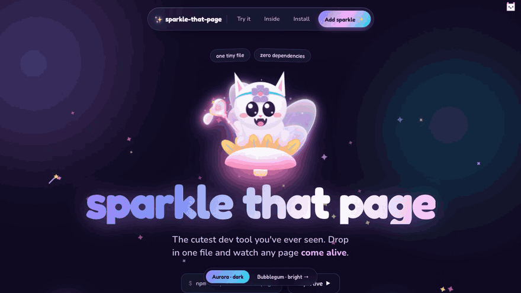
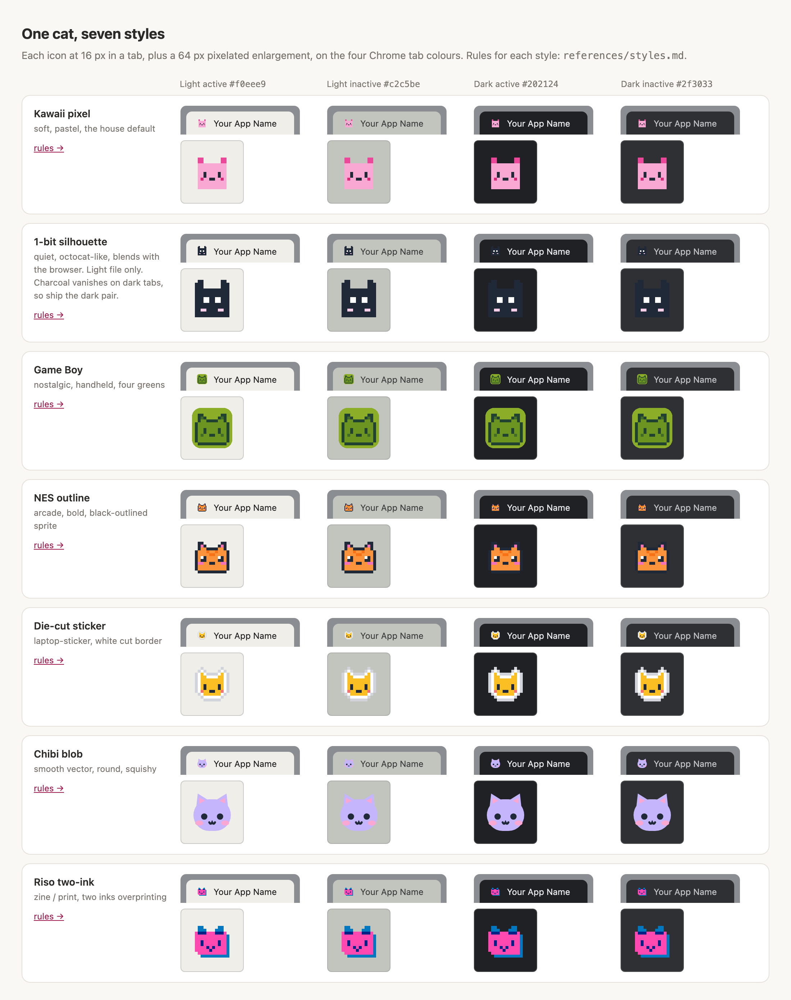
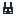
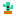
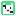
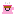
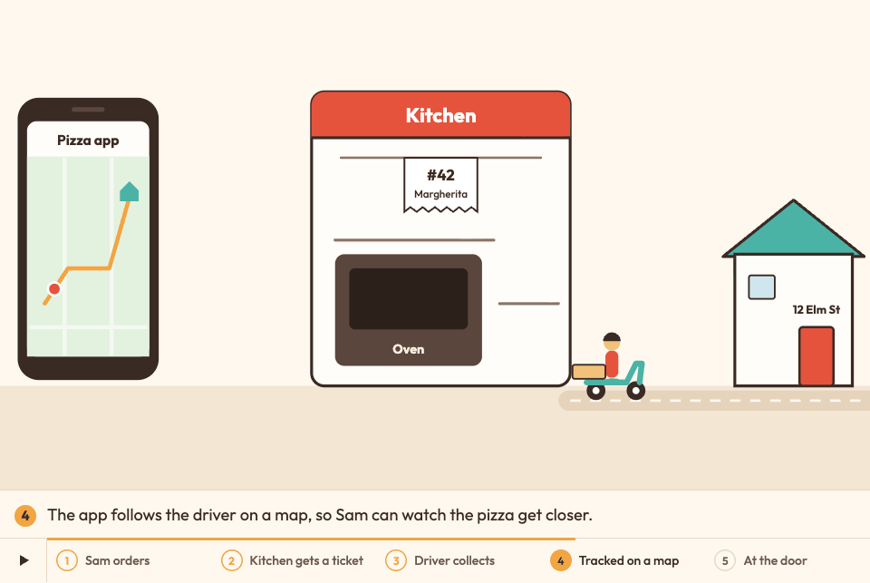

<p align="center">
  <a href="https://wan-huiyan.github.io/cutify-this/site/aurora.html"></a>
  <br/><sub>sparkle-that-page running live on its own landing page: wand cursor, fairy-dust trail, a confetti burst, and the scroll buddy. <a href="https://wan-huiyan.github.io/cutify-this/site/aurora.html">Try it yourself →</a></sub>
</p>

<h1 align="center">cutify-this ✨</h1>
<p align="center"><em>Six Claude Code skills that make the things you build cute, and check that the cute actually works.</em></p>

<p align="center">
  <a href="LICENSE"></a>
  <a href="https://github.com/wan-huiyan/cutify-this/actions/workflows/test.yml"></a>
  <a href="https://github.com/wan-huiyan/cutify-this/commits"></a>
  <a href="https://claude.com/claude-code"></a>
  
</p>

> **Ask Claude to "make it cute" and get a favicon that doesn't vanish in a grey tab, page effects that switch off for people who
> asked for less motion, a terminal whose icons provably render, and a README, an app or an explainer animation with the same
> care. Every skill ships with checks that can fail.**

## 🚀 Install

```bash
/plugin marketplace add wan-huiyan/cutify-this
```

Then install the ones you want (or all six):

```bash
/plugin install cutify-that-tab@wan-huiyan-cutify-this
/plugin install sparkle-that-page@wan-huiyan-cutify-this
/plugin install pop-that-readme@wan-huiyan-cutify-this
/plugin install cutify-that-terminal@wan-huiyan-cutify-this
/plugin install hatch-that-world@wan-huiyan-cutify-this
/plugin install wiggle-that-diagram@wan-huiyan-cutify-this
```

<details><summary>From a terminal instead, all six in one go</summary>

```bash
claude plugin marketplace add wan-huiyan/cutify-this
for p in cutify-that-tab sparkle-that-page pop-that-readme cutify-that-terminal hatch-that-world wiggle-that-diagram; do
  claude plugin install "$p@wan-huiyan-cutify-this"
done
```
</details>

## 🧺 Six skills at a glance

| | Skill | Say this to Claude | You get | Try it |
|---|---|---|---|---|
| ✨ | [**sparkle-that-page**](#-sparkle-that-page--cute-page-effects) | "make this page more magical" | 7 drop-in effects, 24 variants, 3 palettes, zero dependencies | [live demo](https://wan-huiyan.github.io/cutify-this/site/aurora.html) |
| 🎀 | [**cutify-that-tab**](#-cutify-that-tab--a-cute-favicon-that-survives-the-tab) | "put something cute in the browser tab" | 1 SVG favicon from 78 starters in 7 styles, checked against 4 Chrome tab colours | [style gallery](https://wan-huiyan.github.io/cutify-this/plugins/cutify-that-tab/skills/cutify-that-tab/examples/styles.html) |
| 🐛 | [**hatch-that-world**](#-hatch-that-world--your-app-as-a-little-world) | "make this dashboard cute, like the morning brief" | your data drawn as a scene, switchable worlds, a mascot with moods | [morning-fairy](https://github.com/wan-huiyan/morning-fairy) |
| 🪱 | [**wiggle-that-diagram**](#-wiggle-that-diagram--make-a-diagram-explain-itself) | "animate this how-it-works diagram" | a captioned, looping explainer in 3 styles, paced so people can read it | [3 styles](https://wan-huiyan.github.io/cutify-this/wiggle/) |
| ⌨️ | [**cutify-that-terminal**](#️-cutify-that-terminal--a-cute-terminal-that-provably-renders) | "make my terminal prettier" | a theme, a rounded Nerd Font, a Starship prompt, and a check for `?` boxes | macOS + zsh |
| 🪄 | [**pop-that-readme**](#-pop-that-readme--a-readme-that-pops) | "give my README a glow-up" | an 11-section front page in this house style, with a fill-in template | this page |

## 🌱 Used in the wild

<table>
<tr>
<td width="50%"><a href="https://github.com/wan-huiyan/pomodo"></a></td>
<td width="50%"><a href="https://github.com/wan-huiyan/morning-fairy"></a></td>
</tr>
<tr>
<td><sub><b><a href="https://github.com/wan-huiyan/pomodo">Pomodo</a></b>, a team progress board, runs 6 of the 7 sparkle effects, adapted: the wand, the fairy dust, the stars on a click, the tab peekaboo, the floating dust, and Pomo climbing the scroll rail (that's our scroll buddy).</sub></td>
<td><sub><b><a href="https://github.com/wan-huiyan/morning-fairy">morning-fairy</a></b>, a daily brief drawn as a little world, is where hatch-that-world's method comes from: one builder, swappable worlds, a mascot with moods. (Made-up data.)</sub></td>
</tr>
</table>

---

## ✨ sparkle-that-page — cute page effects

**▶ [Live demo](https://wan-huiyan.github.io/cutify-this/) · landing pages: [Aurora (dark)](https://wan-huiyan.github.io/cutify-this/site/aurora.html) · [Bubblegum (bright)](https://wan-huiyan.github.io/cutify-this/site/bubblegum.html)**

Seven self-contained, **zero-dependency** effects: one short vanilla file each, no npm, no build. Wire them with
`<script>` / `<link>`, then choose options with `data-*` attributes on `<html>`.

| | Effect | File | Variants (`data-*`) |
|---|---|---|---|
| 🪄 | Fairy-wand cursor | `fairy_cursor.js` | `data-wand` = star · heart · moon · pixel · sailormoon |
| ✨ | Sparkle trail | `sparkle_trail.js` | `data-trail` = sparkle · star · heart · pixel · fairydust; `data-trail-density="storm"` for the dense version |
| 📜 | Scroll buddy | `scroll_indicator.js` | `data-scroll` = ring · comet · mascot |
| 👀 | Tab-title peekaboo | `tab_title_peekaboo.js` | `data-peekaboo-msg`, `data-peekaboo-favicon` |
| 🎉 | Click confetti | `click_confetti.js` | `data-confetti` = heart · star · confetti · petal · pixel |
| 🌸 | Ambient floaters | `ambient_floaters.js` | `data-floaters` = sakura · leaves · snowflake · bubbles · dust · fairydust |
| 🎀 | Cute chrome | `cute_chrome.css` | `.stp-wobble`, `.stp-spinner`, pastel selection and scrollbar |

**Palettes:** `data-palette` = **candy** (default), **neon** (with glow), **meadow**. All colours come from CSS tokens
`--stp-c1…c6` in `cute_chrome.css`, so one edit recolours every effect.

**Cute, but considerate.** The skill decides *how often* an effect fires before how it looks (the "delight budget",
from Emil Kowalski's [animate](https://github.com/emilkowalski/skills) skill):

| | What | Why |
|---|---|---|
| 🎯 | Confetti fires only on `[data-celebrate]` buttons by default; `data-confetti-on="*"` makes every click burst | A burst on every click of an all-day tool stops being a treat |
| 🌬️ | The trail is sparse by default (a sparkle every 24 px of movement) | A storm is for landing pages, not tools |
| ♿ | With reduced motion on, confetti becomes one small heart that fades in place; the trail and floaters stay off | "Fewer and gentler", not nothing |
| 🖱️ | Pointer effects do nothing on touch screens; overlays never block a click or a scroll | Effects never get in the way |
| 🔬 | Confetti is sharp on Retina screens and runs at the same speed on 60 Hz and 120 Hz displays | Physics is time-based, the canvas matches the screen's pixel density |
| 🧹 | Every effect has `SparkleThatPage.<name>.destroy()` | Clean up on single-page-app route changes |

<sub>Prior art, if you'd rather not hand-author: [tholman/cursor-effects](https://github.com/tholman/cursor-effects),
[party.js](https://party.js.org/), [canvas-confetti](https://github.com/catdad/canvas-confetti),
[tsParticles](https://github.com/tsparticles/tsparticles). This bundle stays dependency-free so Claude can write and
wire every effect for you.</sub>

---

## 🎀 cutify-that-tab — a cute favicon that survives the tab

<p align="center">
  <a href="https://wan-huiyan.github.io/cutify-this/plugins/cutify-that-tab/skills/cutify-that-tab/examples/styles.html"></a>
  <br/><sub>One cat, seven styles, each in a real tab chip on Chrome's four tab colours. <a href="https://wan-huiyan.github.io/cutify-this/plugins/cutify-that-tab/skills/cutify-that-tab/examples/styles.html">Open the gallery →</a></sub>
</p>

One SVG file in the browser tab, instead of the 12-file pack a favicon generator gives you. Every browser since 2020
supports `<link rel="icon" type="image/svg+xml">`.

| | Feature | The specifics |
|---|---|---|
| 🐾 | **78 starters** | 56 pixel-art mascots (animals, sweets, nature, ghosts, silhouettes) and 22 emotion blobs; 13–25 lines each |
| 🎨 | **7 styles** | kawaii pixel, 1-bit silhouette, Game Boy, NES outline, die-cut sticker, chibi blob, riso two-ink: each with rules written to survive 16 px |
| 🎲 | **Explores before it draws** | 6 candidates across at least 3 styles (picked by a real random draw, so not always the pink cat); you choose from the 3 most different |
| ✅ | **A checker that can fail** | `check-favicon.py` scores the icon against Chrome's 4 tab colours, its edge margin and crisp edges: PASS, FAIL or UNCHECKED, with a 17-case self-test. None of the 78 starters fails it |
| 🔍 | **Tab-size preview** | `preview.html` shows your icon at 16, 32 and 64 px in a real tab chip on all 4 colours, light and dark files side by side |
| 🌗 | **Dark mode that works in Chrome** | Two files and two `<link media>` tags; Chrome ignores `@media` inside a favicon SVG |
| ♻️ | **Replacing an icon?** | Bump `?v=2` on the link. Browsers cache favicons by URL, and a hard refresh won't clear it |
| 📚 | **Sources to study, not copy** | Lospec, OpenMoji, Twemoji, Fluent Emoji, Kenney, Phosphor, with their licences checked |

```
You:    the browser tab is a blank square. can you put something cute in there?
Claude: [opens the style gallery, draws 6 candidates in kawaii pixel, NES outline and die-cut sticker,
         runs the checker, shows you the 3 most different]
You:    the NES one
Claude: [writes static/favicon.svg, wires the <link>, checks it on all 4 tab colours] Done. It passes on all four.
```

<details><summary>🖼️ All 78 starters</summary>

<p align="center">

  
  
  
  
  
  
  
  
  
  
  
  <br/>
  
  
  
  
  
  
  
  
  
  
  
  
  <br/>
  
  
  
  
  
  
  
  
  
  
  
  
  <br/>
  
  
  
  
  
  
  
  
  
  
  
  
  <br/>
  
  
  
  
  
  
  
  
  <br/>
  
  
  
  
  
  
  
  
  
  
  
  
  <br/>
  
  
  
  
  
  
  
  
  
  
  <br/>
</p>

Each file is in [`examples/`](plugins/cutify-that-tab/skills/cutify-that-tab/examples), with its name and
vibe listed in the skill's [SKILL.md](plugins/cutify-that-tab/skills/cutify-that-tab/SKILL.md#examples-directory).
</details>

<details><summary>🩺 The four ways a favicon silently breaks (and the fixes)</summary>

| # | Failure | Looks fine in | Breaks in | Fix |
|---|---|---|---|---|
| 1 | **Tab-edge blending** | a preview on a flat dark page | Chrome's rounded tab | a 14×14 tile with a 1-cell outer margin |
| 2 | **Dark-mode mismatch** | one system theme | switching theme | two files + `<link media="(prefers-color-scheme: dark)">` |
| 3 | **Body vanishes on a light tab** | dark previews and dark tabs | Chrome's grey inactive tab `#c2c5be` | tint the body to Tailwind `*-300` or darker, or add a tile |
| 4 | **The old icon won't go away** | incognito | every returning visitor | bump `?v=N` on the `<link>` href |

Number 3 is the subtle one: `prefers-color-scheme` doesn't fix it, because Chrome is in light mode while it shows the
grey inactive tab. The checker catches 1 and 3 before you ship.
</details>

---

## 🐛 hatch-that-world — your app as a little world

<p align="center">
  
  <br/><sub>Built with this method: <a href="https://github.com/wan-huiyan/morning-fairy">morning-fairy</a>'s caterpillar world. (Made-up demo data.)</sub>
</p>

The method behind [morning-fairy](https://github.com/wan-huiyan/morning-fairy), written down so your next cute app
starts from it:

| | Feature | The specifics |
|---|---|---|
| 🗺️ | **The scene is the data** | Pick the axis (hours of today, the last 30 days, a funnel's stages), then map each number to a channel: a running amount → the ground's height, items → objects on it, the overall state → the mascot's mood. Missing data is drawn as missing, never as 0 |
| 🌍 | **Worlds you can swap** | A world = colour tokens + one scene drawing + one sound voice. Adding one touches nothing else: an 8-step checklist and real code in `references/world-anatomy.md` |
| 🖱️ | **Clickable, still accessible** | An invisible layer of real links placed from the drawing's geometry; keyboard order follows time order |
| 🧭 | **Options before building** | An options page with live slices of your real data, and a dated plan per change |
| ✅ | **Checks that can fail** | 3 Playwright scripts, each shown failing on the old version first: `copy_identical.cjs` (copied text unchanged), `pixel_regress.cjs` (other worlds didn't move a pixel) and `hit_check.cjs` (every drawn thing is clickable and lands on its row) |

Needs Node, Playwright and Chrome for the scripts. Pairs with sparkle-that-page and cutify-that-tab.

---

## 🪱 wiggle-that-diagram — make a diagram explain itself

<p align="center">
  
  <br/><sub>Step 4 of 5 in the live style: how a pizza order travels from app to kitchen to door (made-up example). <a href="https://wan-huiyan.github.io/cutify-this/wiggle/">Watch it in all three styles →</a></sub>
</p>

Turn one static "how it works" picture into a short, **captioned, looping animation** for an HTML slide deck or
report, offered in three styles so people can pick:

| Style | Looks like | Made with |
|---|---|---|
| **Diagram clip** | a clean, 3Blue1Brown-style diagram; labels stay sharp | huashu-art-motion engine → text-free video + HTML labels |
| **Whiteboard** | someone explaining at a whiteboard, hand-lettered | huashu-art-motion's whiteboard grammar → square video |
| **Live** | a polished product animation, about 30 KB | inline SVG + GSAP with a virtual camera |

| | What makes it different | The specifics |
|---|---|---|
| 📖 | **Readable, not flashy** | Captions are written first; each step holds for at least `max(4.5 s, words/3 + 1.5 s)`, and `pace_check.py` fails any step shorter than its reading time |
| 🔁 | **One story, three ways** | One caption script feeds all three styles, so a switcher compares styles, not content |
| 🎞️ | **Behaves inside a deck** | One self-contained file per film in an `iframe srcdoc`: step rail, play/pause, reduced motion, and one gesture still moves one slide |
| ✅ | **Checks that can fail** | A pacing gate, contract tests in real Chrome, edge-clipping checks, size budgets, and reviewers who check every word in the picture against the source |

Needs `uv`, Google Chrome, ffmpeg (video styles) and the
[huashu-art-motion](https://github.com/alchaincyf/huashu-art-motion) skill for the two video styles.

---

## ⌨️ cutify-that-terminal — a cute terminal that provably renders

Every terminal-ricing guide ends with "install a Nerd Font, paste this config, enjoy". None of them check. So the
prompt comes back with `?` boxes where the icons should be, and **nothing errored anywhere**: a font name that matches
nothing falls back silently, and a terminal that never got the font just draws boxes.

| | Lever | What it gets you |
|---|---|---|
| 🖥️ | **Terminal** | Ghostty if you have no preference; honest one-liners on iTerm2, kitty, WezTerm and Warp so you can disagree |
| 🎨 | **Theme** | 463 built into Ghostty; `ghostty +list-themes` previews them live. Nothing to install |
| 🔤 | **Font** | A rounded face does more for "cute" than any palette: Maple Mono NF, or Comic Mono if you mean it |
| ❯ | **Prompt** | Starship with the git branch, a dirty-tree mark, and a `❯` that turns red when the last command failed |
| ✅ | **The check** | `verify-glyphs.sh` asks Ghostty which font draws each icon in your real prompt. Exit `0` PASS, `1` FAIL, `3` UNCHECKED, plus `--self-test` to prove the FAIL path still fires |

**The finding it's built on:** Ghostty bundles its own Symbols Nerd Font as a fallback, so icons render in Ghostty even
when your `font-family` is wrong. The terminal you configured looks perfect; only the *other* one shows boxes.

> ⚠️ **One of these is not like the others.** The other skills drop a file into your project and you undo them by
> deleting it. This one **installs software and edits your `~/.zshrc`**, so it backs the file up first, shows you the
> diff, only appends, and gives you the undo in the same breath. macOS + Homebrew + zsh only.

---

## 🪄 pop-that-readme — a README that pops

The skill behind *this* page. It gives Claude a recipe and a fill-in template for a cute, high-signal front page:

| | Feature | The specifics |
|---|---|---|
| 🧱 | **An 11-section recipe** | hero → badges → one bold promise → captioned demo → why → feature table → install → usage → contributors → limitations → footer |
| 🖼️ | **Ready-made heroes** | an ASCII box hero that works anywhere, and a copy-paste pixel-SVG hero |
| ✍️ | **Voice rules** | the promise is one bold sentence; every claim earns a number; emoji as signposts, not decoration; a real limitations section |
| ☑️ | **A pre-ship checklist** | first screen has the hero, 3+ badges and the promise; no 404 badges; renders cleanly on GitHub |

---

## ✅ Checks

```bash
bash scripts/check-all.sh
```

One script runs every check, on every push and pull request (the **tests** badge above). Today it runs 22 checks:

- **Favicons:** the checker's 17-fixture self-test, then every starter SVG on the four Chrome tab colours (0 fail; the
  3 known blobs it can't measure must stay UNCHECKED).
- **Sparkle:** a real Chromium clicks around the demo and checks 6 things: no console errors; the demo's confetti
  fires; by default a plain click draws nothing while a `data-celebrate` click bursts; and with reduced motion a
  click draws a little and is gone within ~700 ms.
- **Syntax:** every shipped script parses (JavaScript, Python, bash, zsh).
- **Wiggle:** the pacing checker passes on the example films, and style C rebuilds byte-for-byte.
- **Repo:** marketplace versions match each plugin, skill names match, and every link in this README points at a real
  file.

The terminal glyph check is skipped on machines without Ghostty, so CI does not cover it.

## 🙈 Limitations

- **Claude Code first.** The skills are written for Claude Code. Other agents can read the `SKILL.md` files, but the
  install commands and some steps assume Claude Code.
- **Favicons are SVG only.** No `.ico` fallback, no `apple-touch-icon` or PWA icons; for a polished brand mark, use a
  designer. Most browsers reject animation inside a favicon.
- **The favicon checker is an early warning, not proof.** Its pass mark is calibrated on 5 field cases, and it can't
  measure outlines or tile-less blobs (3 starters come back UNCHECKED). Look at the real tab before you ship.
- **The terminal skill is macOS + Homebrew + zsh.** The ideas port to Linux; the commands don't.
- **hatch-that-world and wiggle-that-diagram need tools:** Node, Playwright and Chrome; wiggle's video styles also need
  ffmpeg and the huashu-art-motion skill.
- **"Cute" is still judged by eye.** Every check here proves something that can fail (contrast, pacing, glyphs, clicks),
  never that it's charming. Look at it.

## 💛 Credits

- **[huashu-art-motion](https://github.com/alchaincyf/huashu-art-motion)** and **[huashu-design](https://github.com/alchaincyf/huashu-design)**
  by 花叔 (alchaincyf, MIT): the direction method and rendering engine under wiggle's video styles, and the "add
  options, not bans" idea behind cutify-that-tab's style exploration.
- **[animate](https://github.com/emilkowalski/skills)** by Emil Kowalski: the "should it animate at all" frequency
  gate behind sparkle-that-page's delight budget.
- **[tholman/cursor-effects](https://github.com/tholman/cursor-effects)**: the effect vocabulary (fairy dust,
  snowflake, bubble) sparkle-that-page names its variants after.
- **[Lospec](https://lospec.com/palette-list/dmg-nso)**: the Game Boy greens.
- Wiggle's live style uses [GSAP](https://gsap.com) and the fonts [Outfit](https://fonts.google.com/specimen/Outfit)
  and [Kalam](https://fonts.google.com/specimen/Kalam) (OFL); see its
  [`THIRD_PARTY_NOTICES.md`](plugins/wiggle-that-diagram/skills/wiggle-that-diagram/THIRD_PARTY_NOTICES.md).

Made by Huiyan Wan with **Claude** (Anthropic) in Claude Code. Version history:
[cutify-that-tab](plugins/cutify-that-tab/skills/cutify-that-tab/CHANGELOG.md), and the `## Changelog` section at the
end of the `SKILL.md` for [sparkle-that-page](plugins/sparkle-that-page/skills/sparkle-that-page/SKILL.md#changelog),
[cutify-that-terminal](plugins/cutify-that-terminal/skills/cutify-that-terminal/SKILL.md#changelog) and
[pop-that-readme](plugins/pop-that-readme/skills/pop-that-readme/SKILL.md#changelog). For hatch-that-world and
wiggle-that-diagram, see the [commit history](https://github.com/wan-huiyan/cutify-this/commits/main).

## License

MIT, see [LICENSE](LICENSE).
